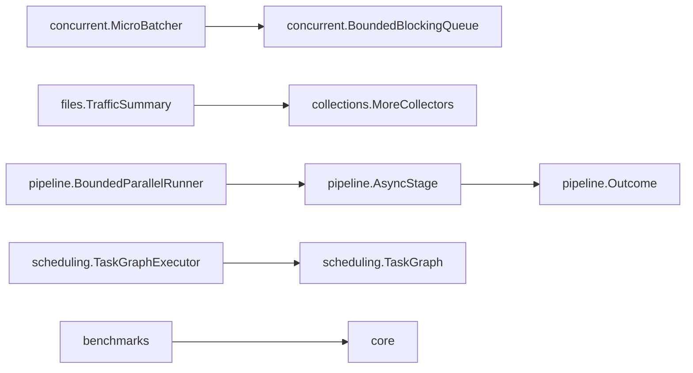

# java-engineering

Concurrency, collections, I/O and performance engineering in Java 21. These are small, self-contained components of the kind found inside real services, each with tests that exercise the hard cases (contention, failures, shutdown), not only the happy path.

> Every component is a learning implementation. The JDK or a mature library (Caffeine, HikariCP, Kafka clients) already provides production-grade versions. Each section below says which one, and why it is still worth understanding how they work.

## 1. Overview

| Component | Problem it solves | Main techniques |
|---|---|---|
| [`ExpiringLruCache`](core/src/main/java/io/github/aki1d/javaengineering/cache/ExpiringLruCache.java) | Cache with size bound, TTL and stampede protection | `ReentrantLock`, access-ordered `LinkedHashMap`, single-flight via `CompletableFuture` |
| [`TaskGraphExecutor`](core/src/main/java/io/github/aki1d/javaengineering/scheduling/TaskGraphExecutor.java) | Run dependent tasks with maximum parallelism | Kahn's topological sort, `CompletableFuture.allOf`, fail-fast cancellation |
| [`BoundedParallelRunner`](core/src/main/java/io/github/aki1d/javaengineering/pipeline/BoundedParallelRunner.java) + [`AsyncStage`](core/src/main/java/io/github/aki1d/javaengineering/pipeline/AsyncStage.java) | Async pipeline with concurrency limit, timeouts, retries and per-item errors | Non-blocking concurrency limiting, decorator composition, sealed `Outcome` |
| [`MicroBatcher`](core/src/main/java/io/github/aki1d/javaengineering/concurrent/MicroBatcher.java) | Producer-consumer batching (size or linger) with backpressure | Bounded queue, `ReadWriteLock` for race-free shutdown |
| [`ResourcePool`](core/src/main/java/io/github/aki1d/javaengineering/pool/ResourcePool.java) | Reuse expensive objects with a hard upper bound | Fair `Semaphore`, LIFO idle deque, try-with-resources leases |
| [`BoundedBlockingQueue`](core/src/main/java/io/github/aki1d/javaengineering/concurrent/BoundedBlockingQueue.java) | Classic monitor-based blocking queue | Lock + two `Condition`s, ring buffer |
| [`LockFreeStack`](core/src/main/java/io/github/aki1d/javaengineering/concurrent/LockFreeStack.java) | Non-blocking stack | CAS retry loop (Treiber), ABA discussion |
| [`AccessLogAnalyzer`](core/src/main/java/io/github/aki1d/javaengineering/files/AccessLogAnalyzer.java) | Summarise gigabytes of logs in parallel with constant memory per file | Virtual threads, NIO, streaming reads, map-reduce merge |
| [`IntArrayList`](core/src/main/java/io/github/aki1d/javaengineering/collections/IntArrayList.java), [`MoreCollectors.topK`](core/src/main/java/io/github/aki1d/javaengineering/collections/MoreCollectors.java) | Memory-efficient primitives; top-k in O(n log k) | Primitive arrays, amortised growth, custom `Collector` |
| [`Account`](core/src/main/java/io/github/aki1d/javaengineering/ledger/Account.java), [`Money`](core/src/main/java/io/github/aki1d/javaengineering/ledger/Money.java) | Immutable, event-sourced domain model | Records, sealed hierarchies, exhaustive pattern matching |

## 2. Engineering objectives

- Show correct concurrent code, and show *why* it is correct: comments explain the invariant, not the syntax.
- Test the concurrency itself. Tests use latches and barriers to force real interleavings, with no `Thread.sleep` guesswork in assertions.
- Make failure behaviour explicit: timeouts, interruption, loader failures, shutdown with work in flight.
- Keep each component small enough to read in one sitting.

## 3. Technology stack

| Tool | Version | Purpose |
|---|---|---|
| Java | 21 (LTS) | Virtual threads, records, sealed types, pattern matching for `switch` |
| Maven (wrapper) | 3.9.16 | Build; `./mvnw` downloads a checksum-verified Maven |
| JUnit Jupiter | 6.1 | Tests, including parameterized tests |
| AssertJ | 3.27 | Assertions |
| Mockito | 5.24 | Verifying interactions with `ResourceFactory` |
| JMH | 1.37 | Micro-benchmarks |
| Spotless + google-java-format | 3.12 / 1.36 | Formatting, checked in CI |
| Checkstyle | 14.4 | Naming, size and complexity rules |
| SpotBugs | 4.10 | Bug patterns, including concurrency bugs |
| JaCoCo | 0.8.16 | Coverage report and an 85% line-coverage floor |

## 4. Repository structure

```
core/src/main/java/io/github/aki1d/javaengineering/
  cache/        ExpiringLruCache, CacheStats
  collections/  IntArrayList, MoreCollectors
  concurrent/   BoundedBlockingQueue, LockFreeStack, MicroBatcher
  files/        AccessLogAnalyzer and its value types
  ledger/       Money, Account, LedgerEvent (domain modelling)
  pipeline/     AsyncStage, BoundedParallelRunner, Outcome
  pool/         ResourcePool, ResourceFactory
  scheduling/   TaskGraph, TaskGraphExecutor
core/src/test/java/...   one test class per component
benchmarks/              JMH benchmarks (separate module, packaged as benchmarks.jar)
config/                  Checkstyle rules and documented SpotBugs exclusions
docs/                    Design notes: cache, JVM and memory
```

## 5. Architecture

The core module has no runtime dependencies. Packages do not depend on each other except where one component is built on another:



## 6. Competency map

| Competency | Where it is demonstrated | Tests |
|---|---|---|
| OOP, SOLID | `ResourcePool` depends on the `ResourceFactory` abstraction (DIP); `AsyncStage` adds timeout/retry by decoration (OCP); `TrafficSummary` has one job (SRP) | [`ResourcePoolTest`](core/src/test/java/io/github/aki1d/javaengineering/pool/ResourcePoolTest.java) |
| Collections Framework | `LinkedHashMap` access order in the cache, `PriorityQueue` heap in `topK`, `ConcurrentLinkedDeque` in the pool | [`MoreCollectorsTest`](core/src/test/java/io/github/aki1d/javaengineering/collections/MoreCollectorsTest.java) |
| Generics | Type-safe heterogeneous container (`TaskKey<T>`), bounded wildcards (`AsyncStage<? super O, R>`) | [`TaskGraphExecutorTest`](core/src/test/java/io/github/aki1d/javaengineering/scheduling/TaskGraphExecutorTest.java) |
| Streams, functional programming | Custom parallel-safe `Collector`; composable `AsyncStage` | [`AsyncStageTest`](core/src/test/java/io/github/aki1d/javaengineering/pipeline/AsyncStageTest.java) |
| Exception handling | Sealed business exceptions vs `IllegalArgumentException` for programming errors; unwrapping `ExecutionException`; loader failures propagated to every waiter | [`ExpiringLruCacheTest`](core/src/test/java/io/github/aki1d/javaengineering/cache/ExpiringLruCacheTest.java) |
| Records, sealed classes | `Money`, `Account`, `LedgerEvent`, `Outcome` | [`AccountTest`](core/src/test/java/io/github/aki1d/javaengineering/ledger/AccountTest.java) |
| Immutable objects | `Money`, `Account`, `TrafficReport` (defensive `copyOf`) | [`MoneyTest`](core/src/test/java/io/github/aki1d/javaengineering/ledger/MoneyTest.java) |
| Multithreading, synchronization, locks | `ReentrantLock` + `Condition`, `ReadWriteLock`, fair `Semaphore` | [`BoundedBlockingQueueTest`](core/src/test/java/io/github/aki1d/javaengineering/concurrent/BoundedBlockingQueueTest.java), [`MicroBatcherTest`](core/src/test/java/io/github/aki1d/javaengineering/concurrent/MicroBatcherTest.java) |
| Lock-free programming | CAS loop in `LockFreeStack` | [`LockFreeStackTest`](core/src/test/java/io/github/aki1d/javaengineering/concurrent/LockFreeStackTest.java) |
| `CompletableFuture` | DAG execution, single-flight loading, retry via `exceptionallyCompose` | [`BoundedParallelRunnerTest`](core/src/test/java/io/github/aki1d/javaengineering/pipeline/BoundedParallelRunnerTest.java) |
| Virtual threads | One virtual thread per file in `AccessLogAnalyzer`; executors in tests | [`AccessLogAnalyzerTest`](core/src/test/java/io/github/aki1d/javaengineering/files/AccessLogAnalyzerTest.java) |
| File processing, NIO | `Files.walk`, streaming reads, malformed-input tolerance | `AccessLogAnalyzerTest` |
| Batch processing, producer-consumer | `MicroBatcher` | `MicroBatcherTest` |
| Memory-efficient processing | `IntArrayList`, streaming log analysis, route normalisation to bound map size | [`IntArrayListTest`](core/src/test/java/io/github/aki1d/javaengineering/collections/IntArrayListTest.java) |
| JVM, memory, GC | [docs/jvm-and-memory.md](docs/jvm-and-memory.md) | — |
| JMH benchmarking | [benchmarks/](benchmarks/src/main/java/io/github/aki1d/javaengineering/benchmarks) | Smoke-run in CI |

## 7. Selected code highlights

1. **Single-flight loading:** [`ExpiringLruCache.get`](core/src/main/java/io/github/aki1d/javaengineering/cache/ExpiringLruCache.java). 32 concurrent misses on one key run the loader exactly once ([test](core/src/test/java/io/github/aki1d/javaengineering/cache/ExpiringLruCacheTest.java)).
2. **Stack-safe concurrency limiting:** [`BoundedParallelRunner.Run.continueLane`](core/src/main/java/io/github/aki1d/javaengineering/pipeline/BoundedParallelRunner.java). Synchronously completed futures are handled in a loop rather than in callbacks, verified with 200,000 items on one lane.
3. **Race-free shutdown:** [`MicroBatcher.close`](core/src/main/java/io/github/aki1d/javaengineering/concurrent/MicroBatcher.java). A read-write lock guarantees that no accepted item is lost when `close()` races with `submit()`.
4. **Fail-fast DAG execution:** [`TaskGraphExecutor`](core/src/main/java/io/github/aki1d/javaengineering/scheduling/TaskGraphExecutor.java). One of the tests uses an instrumented executor to make the "skip after failure" path deterministic.
5. **Exhaustive domain logic:** [`Account.apply`](core/src/main/java/io/github/aki1d/javaengineering/ledger/Account.java). A `switch` over a sealed interface with no `default`.

## 8. Technical decisions

| Decision | Alternative | Why |
|---|---|---|
| One lock in the cache, never held while loading | Lock striping; Caffeine-style read buffers | Simple and verifiably correct; the cost is measured in `CacheReadBenchmark` and discussed in [docs/cache.md](docs/cache.md) |
| Separate loading map (`ConcurrentHashMap<K, CompletableFuture<V>>`) | `ConcurrentHashMap.computeIfAbsent` with the loader inside | `computeIfAbsent` holds a bin lock while the loader runs and forbids recursive loads |
| Results as `Outcome` values in batch processing | Fail the whole batch on the first error | One bad record should not discard 999 good ones |
| `TaskKey<T>` carries a `Class<T>` | `Map<String, Object>` results | Type errors at compile time, no casts at call sites |
| Platform worker thread in `MicroBatcher` | Virtual thread | Long-lived, single thread: virtual threads bring no benefit; the factory is injectable anyway |
| Malformed log lines are counted, not thrown | Fail on first bad line | Logs are external input; partial corruption is normal |

## 9. Getting started

Requirements: JDK 21 or newer. Maven is not required; the wrapper downloads it.

```bash
git clone https://github.com/aki1d/java-engineering.git
cd java-engineering
./mvnw verify          # Windows: mvnw.cmd verify
```

## 10. Configuration

There is no runtime configuration: this is a library. Build-level settings:

| Setting | Location | Default |
|---|---|---|
| Minimum line coverage | `coverage.minimum.line` in `core/pom.xml` | 0.85 |
| Checkstyle rules | `config/checkstyle.xml` | Formatting is left to Spotless |
| SpotBugs exclusions | `config/spotbugs-exclude.xml` | Each exclusion is justified in a comment |

## 11. Running tests and checks

```bash
./mvnw verify                 # compile with -Xlint:all -Werror, tests, Checkstyle, SpotBugs, coverage gate
./mvnw spotless:check         # formatting
./mvnw spotless:apply         # fix formatting
```

The coverage report is written to `core/target/site/jacoco/index.html`. On the last local run the suite had 99 tests, with 96.5% line and 86.7% branch coverage.

Concurrency tests carry a `@Timeout`, so a deadlock fails the build instead of hanging it.

## 12. Performance considerations

Benchmarks live in the `benchmarks` module:

```bash
./mvnw -pl benchmarks -am package -DskipTests
java -jar benchmarks/target/benchmarks.jar                 # all benchmarks
java -jar benchmarks/target/benchmarks.jar CacheRead -t 8  # one benchmark, 8 threads
```

| Benchmark | Question it answers |
|---|---|
| `IntListSumBenchmark` | What do boxing and pointer chasing cost for a sequential scan? |
| `TopKBenchmark` | When does an O(n log k) heap beat sorting? |
| `LockFreeStackBenchmark` | How does a CAS loop compare with `synchronized` and `ConcurrentLinkedDeque` under contention? |
| `CacheReadBenchmark` | What does the cache's single lock cost compared with a lock-free `ConcurrentHashMap` read? |

No numbers are quoted here on purpose: results depend on hardware, JVM version and core count. Run the benchmarks on the machine you care about. CI only smoke-tests that the harness works.

## 13. Security considerations

- No network access, no deserialisation of untrusted data, no reflection.
- `AccessLogAnalyzer` treats file contents as untrusted: malformed lines and invalid UTF-8 are counted, never executed or echoed.
- Resource limits are explicit everywhere: bounded queues, bounded pools, a cap on open files and on in-flight futures. Unbounded growth is a denial-of-service vector.
- CodeQL (`security-and-quality` queries) runs on every push. Dependabot keeps dependencies and actions current.

## 14. Known limitations

- `ExpiringLruCache`: an `invalidate` that races with an in-flight load can be overwritten by the loaded value. Expired entries count towards the size limit until they are read or `cleanUp()` runs. A single lock limits read scalability.
- `TaskGraphExecutor` cannot interrupt tasks that are already running after a failure. It has no per-task timeout (compose `orTimeout` inside the task).
- `AsyncStage.withTimeout` fails the stage but does not cancel the underlying operation.
- `MicroBatcher`: the linger clock starts when the first item is dequeued, not when it is submitted. `close()` can take up to 50 ms longer than the last batch.
- `AccessLogAnalyzer` keeps average and max latency per endpoint, not percentiles. Percentiles need a sketch such as HdrHistogram or t-digest.

## 15. Future improvements

- Replace the cache's lock on reads with a striped read buffer drained under `tryLock` (the Caffeine approach) and compare with `CacheReadBenchmark`.
- Per-task timeouts and cancellation propagation in `TaskGraphExecutor`.
- Latency percentiles in `AccessLogAnalyzer` via a mergeable histogram.
- Run the concurrency tests under [jcstress](https://github.com/openjdk/jcstress) for stronger memory-model guarantees.

## Interview preparation

[INTERVIEW_GUIDE.md](INTERVIEW_GUIDE.md) lists the questions this code invites, with answers, trade-offs, failure scenarios and exercises.

## License

[MIT](LICENSE)
