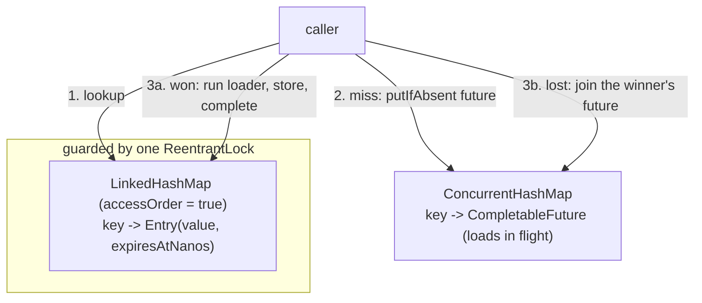

# Design note: ExpiringLruCache

Source: [`ExpiringLruCache.java`](../core/src/main/java/io/github/aki1d/javaengineering/cache/ExpiringLruCache.java)

## Requirements

1. Bounded memory: at most `maximumSize` entries, evicting the least recently used.
2. Freshness: an entry is never returned after its time-to-live.
3. Stampede protection: when a popular key is missing, the backing store sees one request, not one per caller.
4. Loaders may be slow (network calls) and must not block unrelated keys.

## Data structures

- **Access order:** `LinkedHashMap` with `accessOrder = true` moves an entry to the tail on every `get`. The head is therefore the LRU entry, and `removeEldestEntry` evicts it in O(1).
- **Why a lock and not `ConcurrentHashMap`:** in an access-ordered map a read *modifies* the linked list. `LinkedHashMap` is not thread-safe, so every operation, reads included, takes the lock.
- **Why loads are tracked outside the lock:** holding the lock during a 200 ms database call would stall every other caller. The in-flight map lets the lock be held only for O(1) map operations.

## Single-flight protocol

1. Look up the key under the lock. On a hit, return.
2. Create a `CompletableFuture` and `putIfAbsent` it into the in-flight map.
   - If another future was already there, `join()` it: someone else is loading.
3. The winner looks up the key once more. Between step 1 and step 2, another thread may have finished loading and removed its future.
4. The winner runs the loader, stores the value **and only then** removes its future. In the other order, a thread arriving in between would find neither the value nor the future and would load again.
5. Failures complete the future exceptionally, so waiters wake up with the same cause. `Error`s are handled too; otherwise waiters would block forever.

## Time

- `System.nanoTime()` is monotonic. `currentTimeMillis()` can jump with NTP adjustments.
- Expiry is checked with `now - expiresAt >= 0`, never `now >= expiresAt`. `nanoTime` values can overflow, and only differences are meaningful. A test covers the overflow case.
- The ticker is injectable (`LongSupplier`), so tests move time forward without sleeping.

## Known trade-offs

| Issue | Effect | How production caches handle it |
|---|---|---|
| Every read takes the lock | Reads serialise; throughput flattens as cores increase (see `CacheReadBenchmark`) | Caffeine records reads in striped lock-free buffers and replays them under `tryLock` in batches |
| Lazy expiry | Expired entries occupy capacity until read or `cleanUp()` | A timer wheel or a background maintenance thread |
| Invalidate during load | An `invalidate` racing with an in-flight load is overwritten by the loaded value | Version stamps on entries; Caffeine discards a load if the entry was invalidated meanwhile |
| LRU policy | A one-off scan of many keys flushes the hot set | W-TinyLFU (frequency sketch plus admission window) |

## When to use what

- Production on-heap cache: [Caffeine](https://github.com/ben-manes/caffeine).
- Shared across instances: Redis (see the `backend-engineering` repository).
- This class: when you need to explain, in an interview or a design review, what Caffeine does for you.
